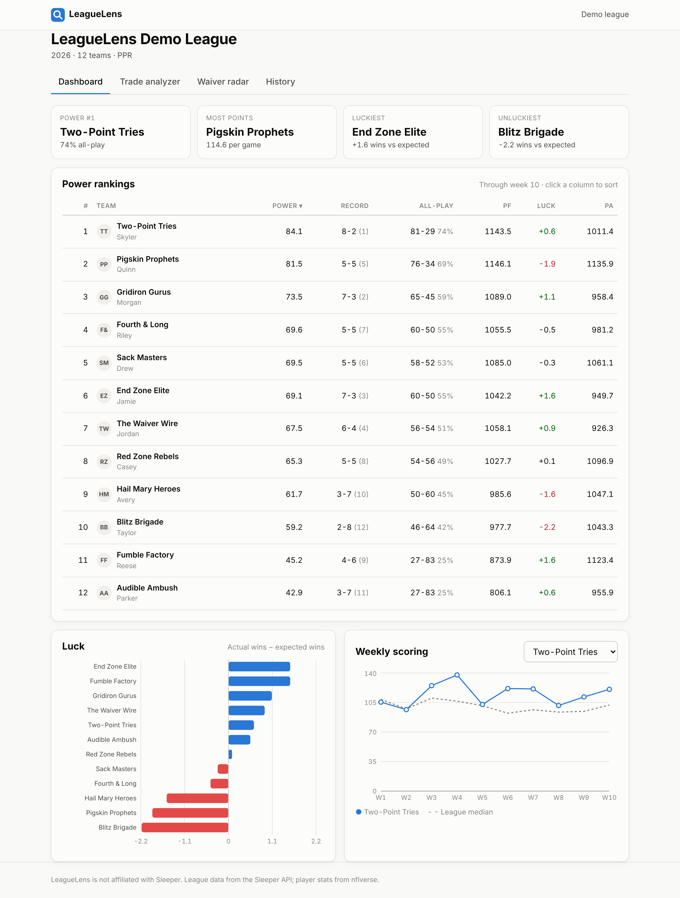
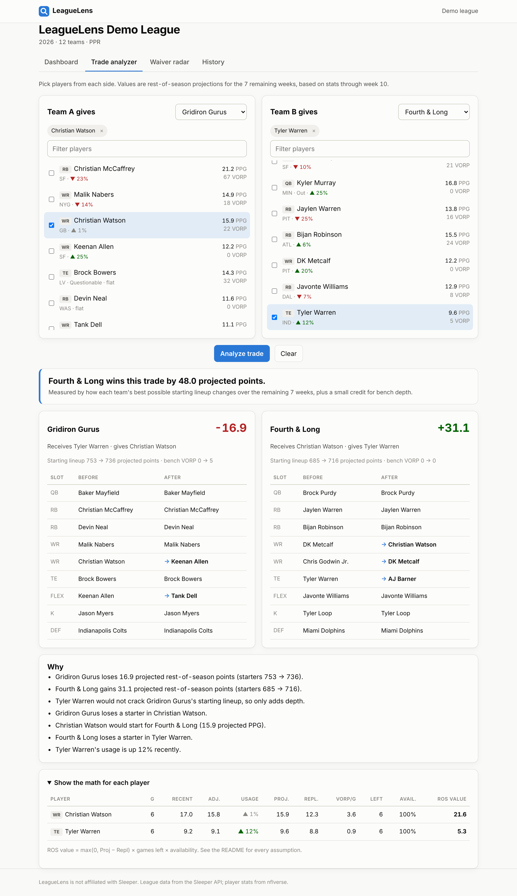
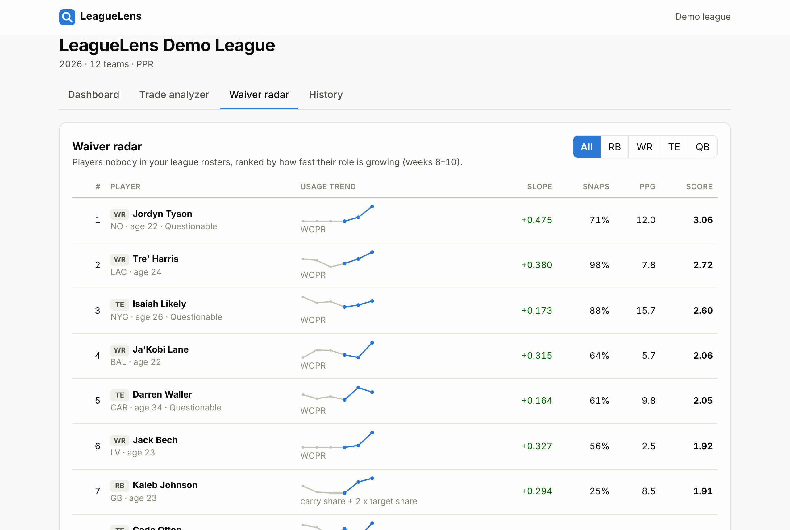
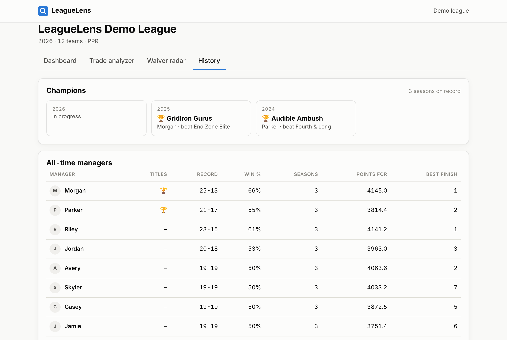
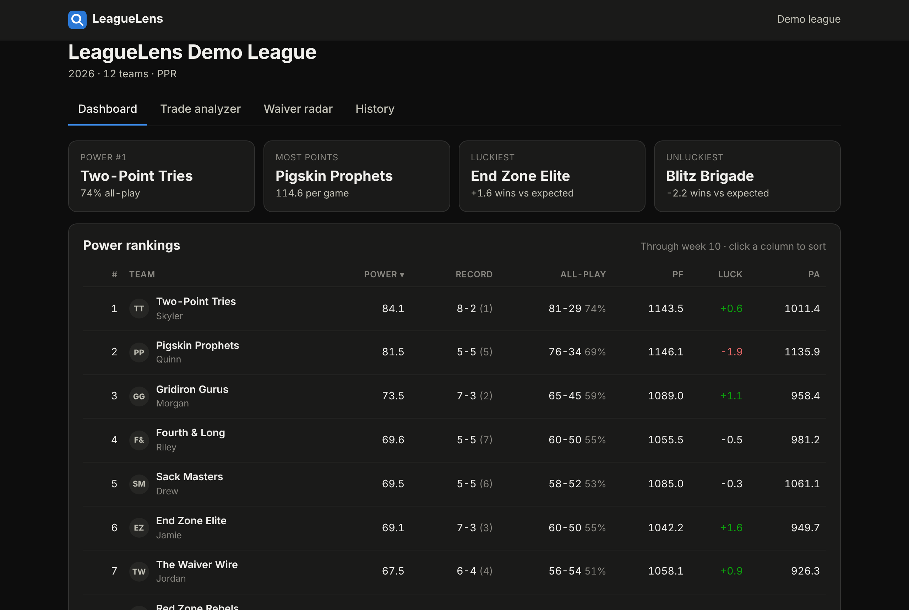
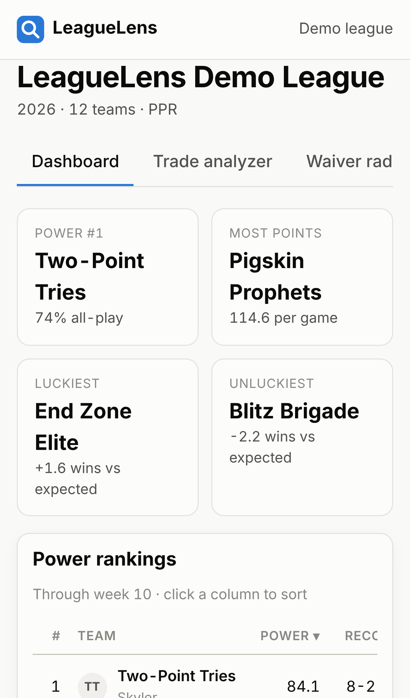

# LeagueLens

**Insights for your Sleeper fantasy football league that Sleeper doesn't give you.**
Enter a Sleeper username, pick a league, and get power rankings with a luck score, a trade
analyzer that shows its reasoning, a waiver radar for rising players, and your league's full
history.



> Want to try it without an account? The app ships with a **demo league**: fictional
> managers, real NFL players and real nflverse stats across three linked seasons. Open
> `/league/demo_2026` or click *Demo league* in the header.

## Features

| | |
|---|---|
| **League dashboard** | Standings plus **power rankings** from each team's *all-play* record (its record if it played every team every week) and points for. A **luck** score compares actual wins with expected wins. |
| **Trade analyzer** | Pick players on each side and see the rest-of-season impact on **both teams' best starting lineups**, using your league's scoring and roster slots. Every number is shown: recent PPG, usage trend, replacement level, VORP, games left, injury discount. |
| **Waiver radar** | Players nobody in your league rosters, ranked by how fast their role has grown over the last 3 weeks (targets, air yards, carry share, snaps). |
| **League history** | Follows `previous_league_id` back through every season: champions, all-time manager records and a head-to-head grid keyed by manager, so it still works when roster IDs change. |

Also: light and dark themes, phone-friendly layout, and route-level code splitting.

| Trade analyzer | Waiver radar |
|---|---|
|  |  |

| League history | Dark mode | Phone |
|---|---|---|
|  |  |  |

## Stack

- **Backend**: Python 3.12, FastAPI, SQLAlchemy 2, Alembic, httpx, Pydantic. Postgres in
  Docker or production, SQLite for zero-setup local development. Tested with pytest, linted
  with ruff, and type-checked with mypy `--strict`.
- **Frontend**: React 19, TypeScript, Vite, React Router, Recharts. Tested with Vitest and
  Testing Library, and linted with oxlint.
- **Infra**: Docker Compose (Postgres, API, refresh worker, nginx), GitHub Actions CI for
  lint, typecheck, tests, migration check, frontend build and Docker build.

## Data sources

Only free, public and permitted sources are used:

- **[Sleeper API](https://docs.sleeper.com)** (read-only, no auth) for users, leagues,
  rosters, matchups, brackets and players.
  - Responses are cached in the database with per-endpoint lifetimes:
    - 5 minutes for live weeks.
    - 10 minutes for rosters.
    - 24 hours for the player list, which Sleeper asks callers to fetch at most daily.
    - Finished weeks and past seasons are kept indefinitely.
  - A token-bucket limiter keeps the API at about 10 requests per second, well under Sleeper's limit.
- **[nflverse](https://github.com/nflverse/nflverse-data)** release files for weekly
  player stats, snap counts, the player ID map and the schedule.

No site is scraped: KeepTradeCut, ESPN, FantasyPros and similar sites are not used.

## Architecture

```
backend/leaguelens/
  clients/      SleeperClient (HTTP / fixture / demo-routing) and nflverse StatsSource
  cache.py      Cache protocol: in-memory and database-backed
  services/     League assembly, standings math, valuation, waivers, history
  valuation/    Pure model: scoring, projections, lineups, trades, waiver scoring
  jobs/         Data refresh CLI and worker (runs separately from the API)
  api/          FastAPI app and routes
frontend/src/   React app: pages per feature, typed API client
```

- **Clients sit behind interfaces.** Tests use `FixtureSleeperClient` and
  `FixtureStatsSource` with recorded JSON and CSV in `backend/tests/fixtures`, so the test
  suite never touches the network.
- **The valuation model is pure.** `leaguelens/valuation` has no I/O. Every tunable number
  lives in `ModelParams`, and the module has its own unit tests.
- **API, jobs and frontend are separate processes.** The API only reads stats from the
  database. The `worker` service (or `python -m leaguelens.jobs`) refreshes the data.
- **Player IDs**: Sleeper fills the nflverse (GSIS) ID for only about 20% of active players.
  LeagueLens links the rest by ESPN ID, then by a unique normalized name plus position,
  which matches about 96% of active skill players.

### API

| Method | Path | Returns |
|---|---|---|
| GET | `/api/health` | Status, database check and last refresh time |
| GET | `/api/state` | Current NFL season and week |
| GET | `/api/users/{username}/leagues?season=` | A user's leagues |
| GET | `/api/leagues/{id}` | League settings and teams |
| GET | `/api/leagues/{id}/dashboard` | Standings, all-play records, power rankings and luck |
| GET | `/api/leagues/{id}/rosters` | Rosters with each player's valuation |
| POST | `/api/leagues/{id}/trade/analyze` | Trade verdict, lineup impact and reasoning |
| GET | `/api/leagues/{id}/waivers?position=&limit=` | Waiver radar |
| GET | `/api/leagues/{id}/history` | Champions, manager records and head-to-head |

Interactive docs are at `http://localhost:8000/docs` when the API is running.

## Local setup

### With Docker

```bash
docker compose up --build
# open http://localhost:8080
```

The API container runs database migrations on start. The worker loads players, the
schedule and current-season stats right away, then refreshes them every 6 hours. The demo
league works as soon as the worker's first run finishes (about 10 seconds).

### Without Docker

Backend (Python 3.12+):

```bash
cd backend
python -m venv .venv && source .venv/bin/activate
pip install -e ".[dev]"
python -m leaguelens.jobs all                 # players, schedule, current-season stats
uvicorn leaguelens.api.main:create_app --factory --reload
```

Frontend (Node 22+):

```bash
cd frontend
npm install
npm run dev        # http://localhost:5173, proxies /api to :8000
```

To add past seasons, which the demo league's history uses, run:
`python -m leaguelens.jobs stats --season 2024 --season 2025`.

### Checks

```bash
cd backend  && ruff check . && ruff format --check . && mypy leaguelens && pytest
cd frontend && npm run lint && npm run typecheck && npm test && npm run build
```

## How the valuation model works

All of this lives in [`backend/leaguelens/valuation/model.py`](backend/leaguelens/valuation/model.py)
and is driven by `ModelParams`. Points always use **your league's** `scoring_settings`
(PPR, half PPR, TE premium, 6-point passing TDs and so on), recomputed from raw nflverse
stats.

1. **Recent points per game.** Take a weighted average of the last 6 games, where the k-th
   most recent game has weight 0.85^k. Small samples are pulled toward the position's
   replacement level: `ppg_adj = (n·ppg + 2·replacement) / (n + 2)`.
2. **Usage trend.** `r = usage over the last 3 games ÷ usage over the 3 games before`,
   limited to between 0.75 and 1.25. Then `proj_ppg = ppg_adj × (1 + 0.5·(r − 1))`, so
   half of a usage change carries through to points.
   - WR/TE usage: WOPR, which is 1.5 × target share + 0.7 × air-yards share.
   - RB usage: share of team carries + 2 × target share.
   - QB usage: pass attempts + 2 × carries.
3. **Replacement level for your league.**
   - **Starters per position:** number of teams × starting slots at that position.
   - **Flex slots:** split by a fixed share (FLEX: 45% RB / 45% WR / 10% TE; SUPER_FLEX: 80% QB).
   - **Replacement player:** the next player after the last starter sets replacement PPG.
4. **Rest-of-season value.**
   - **Formula:** `max(0, proj − replacement) × games left × availability`.
   - **Games left:** taken from the NFL schedule through your league's final playoff week, so byes are excluded.
   - **Availability by injury status:** Questionable 0.95, Doubtful 0.9, Out 0.85, Suspended 0.8, IR/PUP 0.5.
5. **Trade fit.**
   - **Lineups:** for each team, LeagueLens builds the optimal starting lineup before and after the trade, using your league's roster slots.
   - **Gain:** the change in starting-lineup points over the rest of the season, plus 0.15 × the change in bench value.
   - **Effect:** a player who wouldn't start adds only depth, while filling a weak slot adds a lot.
   - **Verdict:** "fair" if the two gains are within 10% of each other; otherwise it names the team that gains more.

**Known limitations in v1.**
- No strength-of-schedule adjustment.
- Kickers and defenses get a flat value.
- No IDP (individual defensive players) or draft picks.
- Rookies and players without stats start at replacement level.
- Early in a season the sample is small and leans on replacement level.

The model is built to be improved one assumption at a time.

**Waiver radar score.**
- **Formula:** `0.6 × z(usage slope over the last 3 weeks) + 0.4 × z(latest week's usage)`.
- **z-scores:** computed within each position, among available players with at least 2 active weeks.
- **Byes:** skipped.

## Demo league

`backend/scripts/make_demo_league.py` generates `leaguelens/demo_data` from stats you have
loaded locally. It works like this:
- **Rosters:** made by a mock snake draft.
- **Weekly scores:** the real fantasy output of a sensible lineup.
- **Seasons:** three, linked through `previous_league_id`.

Any league or user ID starting with `demo` is served from these files instead of Sleeper.
Valuations for the demo league still use live stats from the database.

## Project status

**Not yet tested against a live Sleeper league.** The parts of the code that read Sleeper
league data (league, users, rosters, matchups and the winners bracket) were built from
Sleeper's API documentation and tested only against hand-written fixtures and the generated
demo league. The live NFL state, player list and user lookup endpoints have been called
against the real API. Before public launch, run every endpoint once against a real league
and fix any field differences.

## Roadmap

Planned paid features (freemium):

- **Waiver and injury alerts** by email or Discord when a player on your watchlist breaks out.
- **Dynasty and keeper values**: multi-year aging curves, rookie draft pick values and keeper costs.
- **Multi-league view**: one dashboard across all your leagues, with exposure by player.

Other improvements:
- Strength-of-schedule adjustment.
- Kicker and defense models.
- Trade suggestions ("who would trade for this player?").
- Playoff odds by simulation.
- Use last season's stats in the early weeks.

## License

[AGPL-3.0](LICENSE). LeagueLens is not affiliated with Sleeper or the NFL.
